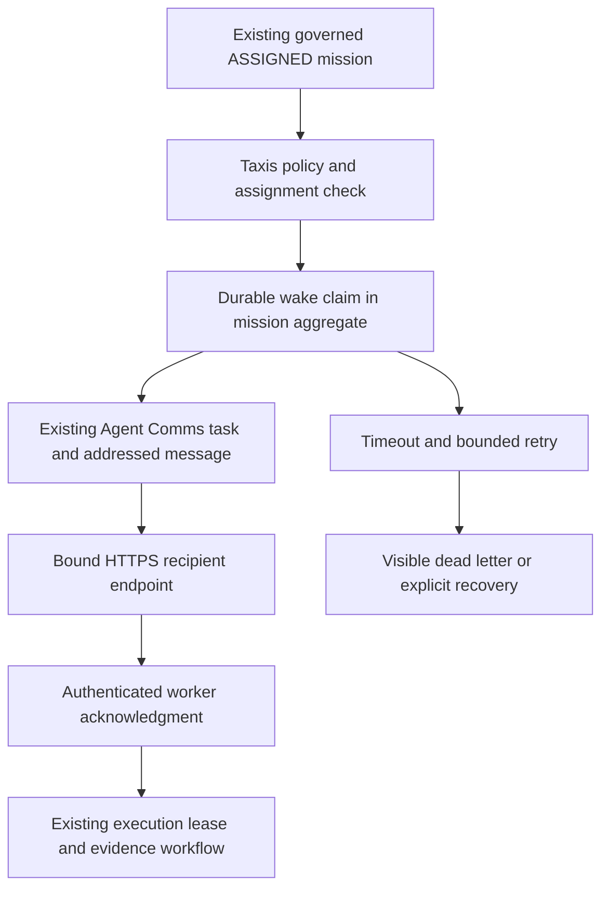

# TIP / Taxis reactive delivery — implementation handoff

Status: **IMPLEMENTED FIRST SLICE; NOT DEPLOYED; FULL MISSION NOT COMPLETE.**

This extends the existing Runtime 002/003 continuation at
`bcd0d0ef324ef1a5ff9ffdfb4a7093d865070033` (TIP PR #11). It does not
replace Agent Comms, Taxis, the registry, the mission repository, or PIE.
No new infrastructure, database, migration, model account or paid call is included.

## Observed current state

Command Center candidate is live at `030c1d559bc50a96f2ec0cb3fb1f94a8805024f7`,
Render deployment `dep-dbenhaavcj2c73dhil60`, completed
2026-10-25T03:34:45.079823Z (October 24, 11:34 PM EDT).
The deployed PIE-002 proposal slice explicitly keeps dispatch disabled.
TIP production remains a separate main lineage; it is not this runtime continuation.

Inspected CC `server/agent-comms.ts` exposes request/response ledger operations,
including an explicit recipient acknowledgment endpoint. Its `mcp/README.md`
explicitly disclaims idle-agent wake and always-on operation. No outbound
assignment subscription/webhook dispatcher is exposed by that route inventory.
MCP Streamable HTTP is a client transport, not proof of a provider execution trigger.
No provider-wide claim about what ChatGPT/Gemini/Grok products might support is made.

The actual preview ledger was read as CHATGPT_WORK at checkpoint 35. Its permissions
are read/post_message/post_handoff/post_blocker; PRJ-TIP/development read is denied.
Those permissions are insufficient for the dedicated execution/delivery host.
Existing Gemini and SUPERGROK acknowledgments/replies are present. Their native
connections are not newly certified by this work.

Live endpoint discovery request `MSG-eaa6fd3c-5fb2-4959-81c0-63e0c4505fca`,
correlation `TIP-TAXIS-REACTIVE-20261024`, was durably recorded to GROKBOT_COS
at 2026-10-25T03:42:11.997Z (October 24, 11:42 PM EDT), checkpoint 36.
A subsequent delivery read still reported unacknowledged/no work started.
This is a real ledger observation, **not a timed wake acceptance test**.
Earlier runtime assignments at checkpoints 34–35 also lacked acknowledgments.

The trusted repository-inspection runtime catalog currently declares
AGENT-REPOSITORY-INSPECTOR. OAuth actors such as GEMINI/CHATGPT_WORK/SUPERGROK
are not automatically capability manifests, runtime workers, or execution endpoints.
The user's label “Supergrac” has not been silently made a new registered identity.
No native chat is remotely controllable merely because it has an MCP grant.

## Implemented path

`runtimeWakeDispatcher.ts` stores wake state in the existing mission JSON aggregate.
Existing compare-and-swap revisions fence concurrent schedulers. Mission creation
and durable assignment already occur before dispatch; an unprocessed assignment
can be discovered after restart without a process-local queue. Wake metadata changes
also use existing mission persistence and existing packet delivery mappings.

The disabled-by-default server scheduler scans eligible assignments every five
seconds, up to 100 due records per tick and four concurrent attempts. Waiting and
dead-letter records cannot occupy that bounded due-record page indefinitely.
This is durable recovery polling followed by outbound event delivery, not a claim
of database LISTEN/NOTIFY or an always-running free host. It wakes selected bound
recipients only; arbitrary ledger notes never become executable tasks.

The exact addressed assignment is recorded on Agent Comms before the endpoint call.
A preflight requires the actual ledger viewer to be TIP with read/post_status/
post_evidence/post_message grants before any packet/task write; a CHATGPT_WORK
credential cannot claim to be the TIP sender.
`createWakeLedgerRecorder` reuses the existing packet/task bridge. It checks the
project mapping, exact task/message identity, correlation and recipient on replay.
A lost committed response is recovered by reading the existing message. A changed
checkpoint conflict is paused for review, not silently rebased onto new authority.

The envelope carries sender TIP, actual Comms recipient, separately named runtime
agent ID, mission/task/message/correlation/handoff IDs, required capability, normal
priority, project/permissions/policy fingerprint, a fixed ten-minute delivery deadline,
expected acknowledgment and evidence requirements. It contains no credentials or
execution lease. The recipient retrieves current mission state through its scoped
worker API; envelope authority is informational and cannot authorize execution.

## State, reliability and recovery

| Fact | Representation |
| --- | --- |
| Assignment durably exists | Existing ASSIGNED mission/delegation |
| Attempt owns dispatch | DISPATCHING with CAS revision and expiring token |
| Addressed message recorded | recorded_at plus existing Agent Comms record |
| Endpoint accepted delivery | SENT/sent_at; HTTP 2xx only |
| Transport failed/uncertain | RETRY_PENDING and fixed error code |
| Recipient acknowledged | ACKNOWLEDGED, authenticated actor/time, unchanged ASSIGNED state |
| Work started | Existing RUNNING transition and execution lease |
| Evidence/result ready | Existing stored artifact/hash and REVIEW workflow |
| Technical review/completion | Existing explicit operator review; no authority expansion |
| Independent correctness / PIE resolution | Still NOT_RECORDED until separately established |

Three automatic attempts maximum. Network errors and HTTP 408/429/5xx retry with
5s/10s exponential backoff; successful transport waits for acknowledgment plus
5s/10s/20s backoff. The dispatch lease is 30s; HTTPS send/DNS wait is bounded by
the ten-second abort signal. A host restart can reclaim an abandoned expired
dispatch lease. Acknowledgment without execution for 120s becomes START_TIMEOUT.
Assignments older than their fixed delivery window become STALE_ASSIGNMENT.
Permanent authentication/validation/checkpoint failures dead-letter immediately.
No retry failure changes a mission into COMPLETED or silently removes it.

Recipient acknowledgment is the new authenticated worker command
`acknowledge_wake`, with command ID, expected revision and wake ID. It requires the
current assignment and policy, a recorded unexpired attempt and the assigned worker
principal. Operators cannot acknowledge as the recipient. Execution still separately
requires the existing claim/lease. Fast acknowledgment cannot be overwritten by a
late sender response. Historical polling workers without wake metadata retain their
existing behavior. Pending handoff notification itself remains a later integration.
This acknowledgment is recorded in TIP's durable aggregate. It does not forge the
separate Agent Comms recipient acknowledgment; a recipient adapter must write that
through its own authorized Comms session when completing the full integration.

An operator may issue `retry_wake` only for a current dead-letter assignment, with
an explicit expected revision and note. This archives the failed wake and starts a
new bounded generation with new message/dedup identity. Assignment changes archive
previous wake metadata too. Workers cannot authorize their own delivery reset.
No automatic alternate selection changes authority; dead-letter is the supported
failure outcome when no bound alternate is available.

## Host binding and activation boundary

Configuration names, never secret values:

* Existing TIP_ENV=development, durable persistence and correct isolated tip_core DB.
* Existing TIP_RUNTIME_CATALOG and TIP_WORKER_CREDENTIAL_DIGESTS.
* Existing TIP_COMMAND_CENTER_PROJECT_MAPPINGS, TIP_CC_EXISTING_TOKEN and
  TIP_RUNTIME_DELIVERY_ENABLED=true, with an explicitly authorized narrow host grant.
* New TIP_RUNTIME_WAKE_ENABLED=true only after preflight.
* New TIP_RUNTIME_WAKE_BINDINGS JSON: array of agent_id, comms_recipient, HTTPS url,
  token_env. token_env must name a separately configured TIP_WAKE_TOKEN_* secret.

An explicit comms_recipient is mandatory; runtime IDs never silently become native
provider identities. Bindings add transports, not registry capabilities or permissions.
The scheduler refuses startup without durable development storage, an operator
secret, ledger delivery transport/mapping, an active manifest and worker credentials
for each configured binding. Endpoint URLs cannot come from mission/ledger bodies.
Only credential-free HTTPS URLs on port 443 are accepted; public IPv4 DNS answers
are checked and pinned to the TLS request, redirects are rejected, and response
bodies cannot issue commands. IPv6-only recipients are currently unavailable.

Activation is **blocked by unavailable execution-host/endpoint credentials and
recipient bindings**, not by a request to approve routine engineering. No existing
OAuth, browser or unrelated account secret was repurposed. No supported live runtime
endpoint for two recipient agents was established. Creating a paid API arrangement,
new account, or expanding sensitive permissions remains outside automatic activation.

Rollback: keep TIP_RUNTIME_WAKE_ENABLED unset/false. No migration rollback required;
retain delivery/acknowledgment history. This branch does not merge or deploy TIP
main, change the current CC candidate, rotate secrets or change domains.

## Executive surface and notification policy

Authenticated GET `/v1/runtime/orchestration` projects mission title, status, owner,
current step, wake status/attempts, blockers, approval flag and result. Dispatch fence
tokens are absent from this projection and redacted from worker responses/history.
Details remain in the authenticated mission record. This is a read-model endpoint;
the existing Command Center frontend has **not** been wired to it in this slice.

Projected notices include stable dedup IDs for APPROVAL_REQUIRED and MATERIAL_BLOCKER.
Routine recorded/sent/acknowledged/heartbeat traffic produces no executive notice.
The response explicitly reports notification_delivery=NOT_CONFIGURED. No email,
push notification, Slack message or completed mission report has been sent to Dot.
MISSION_COMPLETE must wait for the later independent review/fresh observation
integration; a runtime COMPLETED claim alone is insufficient. MATERIAL_RISK and
MAJOR_PLAN_CHANGE require structured signals not yet implemented here.

Target discussion policy for the remaining coordinator integration: primary owner
may request one justified specialist consultation; Taxis selects capability/authority;
maximum two consultation rounds, no recursive invitations, retain recommendations
and evidence, stop on sufficient evidence or escalate unresolved material disagreement.
These are documented bounds, **not an implemented discussion engine**.

## Validation and acceptance ledger

Local validation: 95/95 tests passed across mission lifecycle, worker, delivery,
inspection, CC bridge and new wake suite (14 new cases). Core/API typechecks pass;
Taxis Runtime 001 and foundation contract checks pass. CI additionally executes the
wake suite. Database restart checks use disposable disk-backed PGlite/PostgreSQL
engine, not the hosted production database. Stub recipient calls and fake credentials
are controlled tests, not independent agents or provider model execution.

New cases prove separate record/send/ack/start, same-mission concurrency fencing,
fast acknowledgment, identical retry envelopes, timeout/dead-letter, network backoff,
authorization refusal, start timeout, operator recovery, stale window, cancellation,
policy revocation, redacted authenticated reads, endpoint validation, lost-response
deduplication and disk reopen/abandoned-lease recovery.

| Requested deliverable | This release / remaining work |
| --- | --- |
| 1. Current delivery assessment | Source + real ledger observations above |
| 2. Gap analysis | Scope and acceptance table below |
| 3. Final architecture | Existing runtime extended by the bounded wake slice; full target architecture still pending |
| 4. Event/wake mechanism | Disabled scheduler + ledger-first HTTPS wake transport implemented |
| 5. Taxis dispatcher | Existing policy/assignment gating reused, CAS dispatcher implemented |
| 6. Mission/task model | Existing aggregates plus durable wake metadata; no parallel bus |
| 7. Routing | Existing manifests/resolver preserved; explicit transport identity bindings added |
| 8. Retry/dedup | Implemented and controlled-tested; receiver must honor wake ID idempotency |
| 9. Governance | Existing execution/approval/worker boundaries preserved |
| 10. Dot notification policy | Partial notice projection, no owner delivery channel |
| 11. Discussion protocol | Documented target bounds; not implemented |
| 12. PIE closed loop | Existing PIE proposals remain disabled; no automatic proposal-to-runtime or fresh-resolution integration |
| 13. Command Center UX | Runtime executive read model added; CC frontend integration pending |
| 14. Automated tests | 14 new tests plus 81 existing runtime regressions |
| 15. Real multi-agent acceptance | NOT RUN: two supported live execution endpoints/credentials unavailable |
| 16. Failure/recovery evidence | CONTROLLED ONLY: unavailable/ack timeout/backoff/retry limit/dead-letter/reopen |
| 17. Deployment verification | NOT DEPLOYED: no safe configured runtime host/bindings; current CC deployment merely observed |
| 18. Release handoff | This document and isolated PR; do not mark full mission complete |

Sequential/parallel dependency graphs, automatic verifier dispatch, agent review
authority, pending handoff wake, consultation limits enforced in code, independent
resolution records, Dot report delivery and fresh PIE re-observation remain gaps.
The four-attempt concurrency window supports independent existing assignments;
it is not a dependency-graph planner. No full acceptance evidence is fabricated.

Next concrete gate: obtain supported machine-invokable runtimes for two selected
registry agents, secure their independent host credentials and narrowly authorized
ledger mapping on the existing development runtime. Then run the user's complete
15-step no-human-relay mission and controlled failure on that host, retaining every
timestamp, message/ack/lease/evidence/review/fresh-observation ID. Native OAuth chat
connections alone cannot satisfy that gate.

## Concurrent coordination update

SUPERGROK native message MSG-8d2a70ca-dec4-48a5-91e8-a0d32af3b7b3 at
2026-10-25T03:43:15.619Z independently reports pull-only behavior and says its
prior round trip required Dot to open the chat. Its proposed Automations webhook
capability remains an attributed claim until the actual trigger/auth schema and
receiver are inspected. CHATGPT_WORK explicitly acknowledged this message in
ACK-be07e26a-49d3-4d0e-b9e5-e7a3a660991b at03:54:38.144Z.

Bounded receiver capability assignment MSG-2b80489e-4c05-4aa3-b665-4146e3024b7a
was recorded to SUPERGROK at03:54:54.513Z, checkpoint40. It requires verification
of an existing free event trigger, bearer/idempotency support, real session wake
and its own scoped acknowledgment. It forbids secret URLs/keys in the ledger,
new accounts/spend, unapproved authority and duplicate source edits. It is not
an automatic delivery result. Reviewed concurrent CC progress before writing;
checkpoint conflicts were not blindly retried. Updated CoS coordination record
MSG-088bd887-de42-4d08-aa9c-6320d541831b is checkpoint41.

PR13 initial implementation head88a8a82c passed GitHub TIP CI40159901368 and
API Smoke40159901529. The follow-up dedicated-TIP-identity guard is independently
controlled-tested before commit; see PR conversation for its exact-head CI results.
